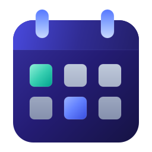
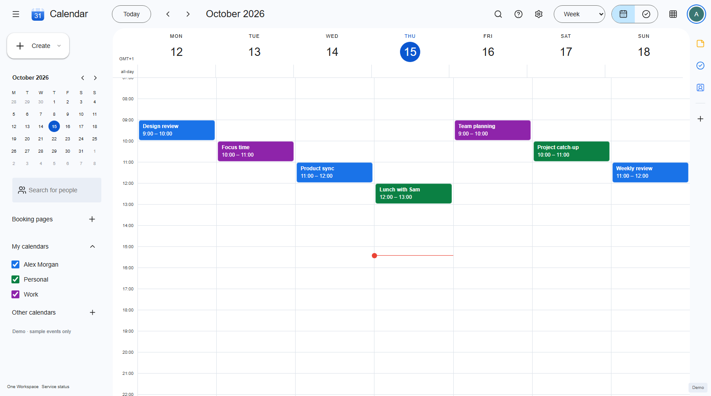
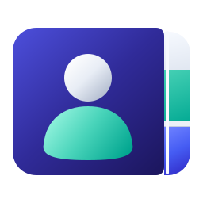

#  My Calendar

Your day, together. A familiar calendar for **One Workspace**, with your events stored on your own server.

[Download for Windows](https://github.com/oneworkspacestudio/calendar/releases) · [One Workspace](https://github.com/oneworkspacestudio/one-workspace) · [Setup & technical guide](docs/TECHNICAL.md)

## A clear view of your time

Move between **day, week, month, year and schedule** views. Create events, add a location or meeting link, set reminders, and organise your time with coloured calendars. Search, drag events to a new time, or resize them on the calendar.

Repeating events support changes to one occurrence or the whole series. Time zones and daylight-saving changes are handled in your calendar data. Import or export standard `.ics` files to move your events between calendar apps.

##  Contacts included

Calendar and Contacts each have their own icon and interface in One Workspace.

## One account. One shared service.

Sign in with **MyAccounts**, the same account used by the rest of your workspace.

| Application | What it does |
| --- | --- |
| **My Calendar** | Events, schedules and calendars. Runs without Mail. |
| [**My Mail**](https://github.com/oneworkspacestudio/mail) | Your inbox, using the same Stalwart service. |
| **My Contacts** | A separate Windows app for your contacts, included in this preview. |

The first app sets up the shared service. Adding another app reuses it and keeps your existing data. Removing an app leaves the shared service and the other apps intact.

## Get started

1. Download the **Windows portable package** from [Releases](https://github.com/oneworkspacestudio/calendar/releases) and extract it.
2. Open **Calendar.exe**. On first use, the setup screen connects your MyAccounts server. A workspace administrator supplies the shared client connection once.
3. Sign in and start planning. Open **Contacts.exe** separately whenever you need it.

The shared `WorkspaceServices.exe` manager and separate `stalwart.exe` are included. You do not need to install My Mail, Docker or a document server to use Calendar. A helper installer can install just the app you choose; see the [Windows guide](docs/TECHNICAL.md#windows-installation).

Your program files can live on another drive. Private settings and databases use a protected NTFS folder, with a separate persistent folder for the shared service.

## Made to keep your data

- Your calendars and contacts stay in the shared Stalwart data folder.
- Each person accesses their own data through their MyAccounts identity.
- App installation and removal do not reset the shared database.
- Public email ports stay closed until the installation owner explicitly configures them.
- Existing Mail installations and external Stalwart servers are never silently adopted.

[Backup and recovery](docs/TECHNICAL.md#backup-and-recovery) · [Shared-service architecture](docs/TECHNICAL.md#shared-service) · [Verification](docs/VERIFICATION.md)

## Preview status

This is an **unsigned Windows x64 preview**. The Calendar interface follows the current Google Calendar desktop layout with One Workspace branding. It is an independent application, not a Google service.

Google Meet, Google Tasks synchronisation, public appointment-booking pages, a full calendar-sharing administration UI and automated invitation delivery are not included. Meeting URLs and guest details can be saved in events; local reminders require the app to remain open. Tasks are stored as Calendar items. New timezone definitions cover 1970–2100; imported calendar definitions are retained.

Native install-order, OIDC, user-isolation, recovery and application checks are documented in [Verification](docs/VERIFICATION.md). A clean Windows machine, Windows service/logon reboot and public HTTPS deployment remain separate acceptance checks.

## For developers and administrators

[Technical guide](docs/TECHNICAL.md) · [Original brief](BRIEF.md) · [Source and licences](NOTICE.md) · [Shared backend integration for other apps](docs/INTEGRATION.md)
